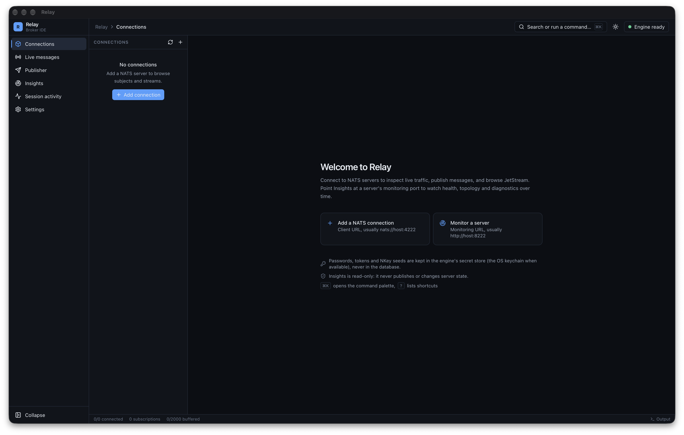
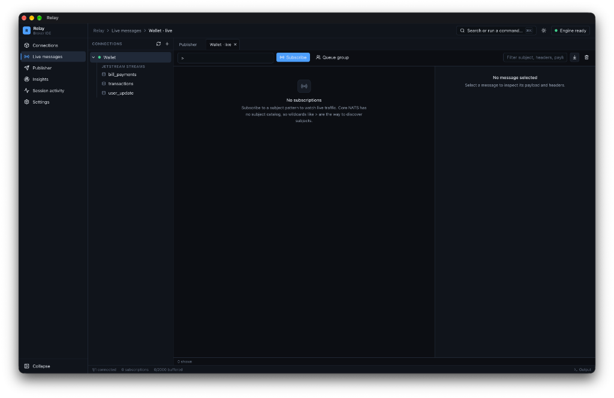
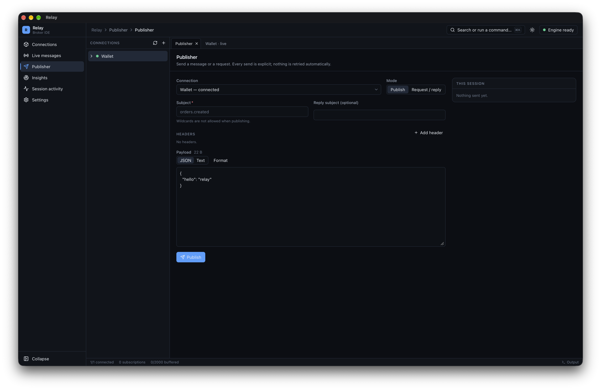
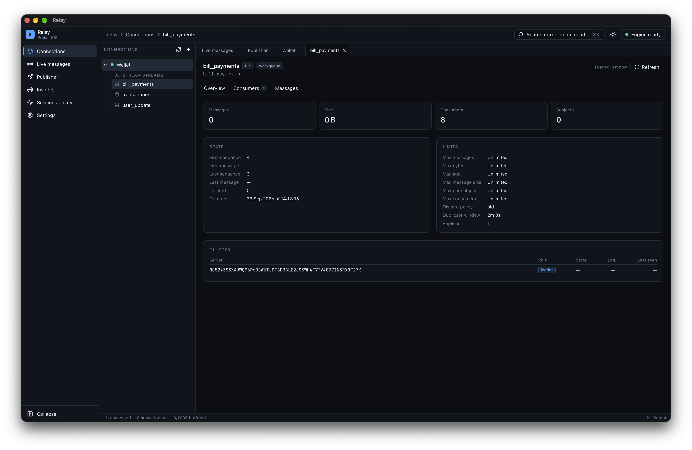

# Relay

Relay is a local-first desktop IDE for exploring, debugging, testing, and monitoring message brokers.

**Current focus:** NATS IDE workflows plus an **Insights** observability workspace (monitoring HTTP collector, topology, snapshots, findings). RabbitMQ and Kafka adapters are planned.

## Preview

<p align="center">
  <a href="docs/images/welcome.png"></a>
</p>

<p align="center">
  <a href="docs/images/live-messages.png"></a>
</p>

<p align="center">
  <a href="docs/images/publisher.png"></a>
</p>

<p align="center">
  <a href="docs/images/jetstream-stream.png"></a>
</p>

## Architecture

```text
React UI  ↔  Tauri host  ↔  Go engine (sidecar)  ↔ Message Brokers
```

IPC is versioned NDJSON over stdin/stdout. See [docs/architecture.md](docs/architecture.md) and [docs/ipc-protocol.md](docs/ipc-protocol.md).

## Supported platforms

- macOS (Apple Silicon and Intel where dependencies allow)
- Windows x64
- Linux x64

Platform packaging is implemented via Tauri; signed/notarized installers are not claimed until completed.

## Download and install

Prebuilt apps are in [`releases/`](releases/).

### macOS (Apple Silicon)

1. Download [Relay_0.1.0_aarch64.dmg](releases/Relay_0.1.0_aarch64.dmg).
2. Open the disk image and drag **Relay** into **Applications**.
3. Launch Relay from Applications.

The build is **not signed or notarized**, so macOS Gatekeeper may block the first open:

- In Finder, right-click Relay → **Open**, then confirm **Open**, or
- Clear the quarantine flag once:

```bash
xattr -dr com.apple.quarantine /Applications/Relay.app
```

This DMG is for Apple Silicon only (M1/M2/M3/M4). Intel Mac, Windows, and Linux installers are not in `releases/` yet — build from source with `make build` on those platforms.

## Prerequisites

- Go 1.26+ (as declared in `engine/go.mod`)
- Node.js 20+
- Rust (stable) + Tauri CLI prerequisites for your OS
- A NATS server: either Docker (`make brokers-up`) or a local `nats-server`
  binary (`go install github.com/nats-io/nats-server/v2@latest`)

## Quick start

```bash
make setup
make brokers-up   # Docker: NATS with JetStream on :4222, monitoring on :8222
# or, without Docker:
nats-server -js -m 8222 &
make dev          # builds the Go engine and launches the Tauri app
```

In the app:

1. Add a NATS connection (`nats://127.0.0.1:4222`), test it, and save and connect
2. Open Live messages and subscribe to a subject (e.g. `>`)
3. Publish from the Publisher
4. In Insights, add a monitored system for `http://127.0.0.1:8222`

### Running the UI in a browser (development only)

`make dev-browser` starts `scripts/dev-bridge.mjs`, which runs the real engine
and exposes it on `127.0.0.1:1422` behind a random bearer token, then starts
Vite on `http://localhost:1420`. The bridge keeps its data in `.tools/dev-data`
(separate from the desktop app's data) and writes the token to
`apps/desktop/.env.development.local` (gitignored). It is never bundled.

## Commands

| Command | Description |
|---------|-------------|
| `make setup` | Install JS deps and build the engine |
| `make engine` | Build the Go sidecar for the current target |
| `make dev` | Run the desktop app in development |
| `make dev-browser` | Run the UI in a browser against the real engine (dev only) |
| `make test` | Go unit tests with the race detector, TypeScript check, Vitest |
| `make test-integration` | Docker NATS + Go integration tests |
| `make test-integration-local` | Go integration tests against an already running `nats-server` (`RELAY_NATS_MONITOR_URL`, default `http://127.0.0.1:8222`) |
| `make lint` | go vet, gofmt (fails on unformatted files), TypeScript |
| `make build` | Release build via Tauri |
| `make brokers-up` / `brokers-down` | Local NATS via Docker Compose |

## Security

- Secrets use the OS credential store (file-backed fallback for headless CI only, with a visible warning)
- TLS certificate validation is enforced; credentials in URLs are rejected
- Message bodies are kept in memory only and never persisted
- Insights is read-only: it only issues HTTP GETs to monitoring endpoints

See [docs/security.md](docs/security.md) and [docs/diagnostics.md](docs/diagnostics.md).

## Status

See [docs/production-readiness.md](docs/production-readiness.md) for the verified checklist, commands run and remaining blockers, and [docs/implementation-status.md](docs/implementation-status.md) for feature scope.

## License

[Apache License 2.0](LICENSE) — Copyright 2026 Bisar Omer
